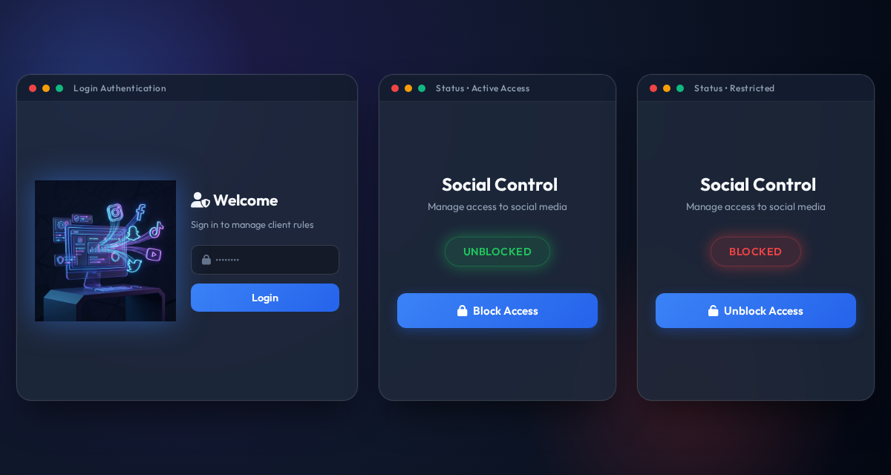
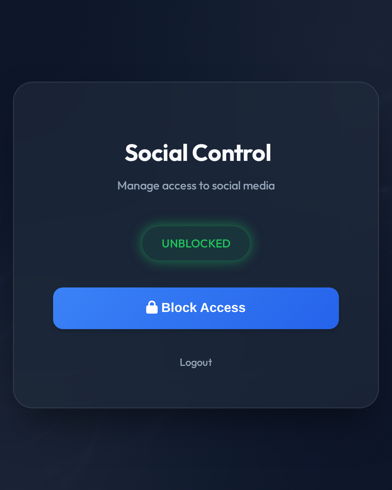
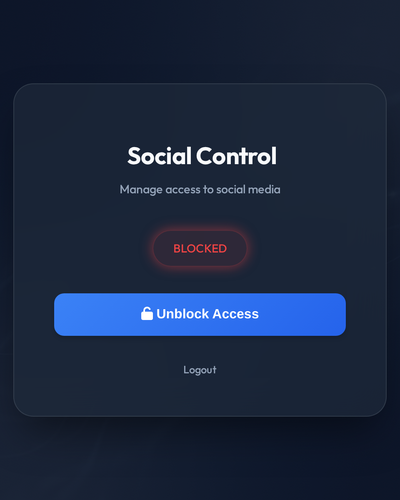
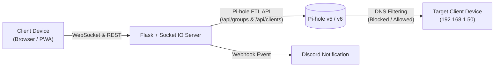
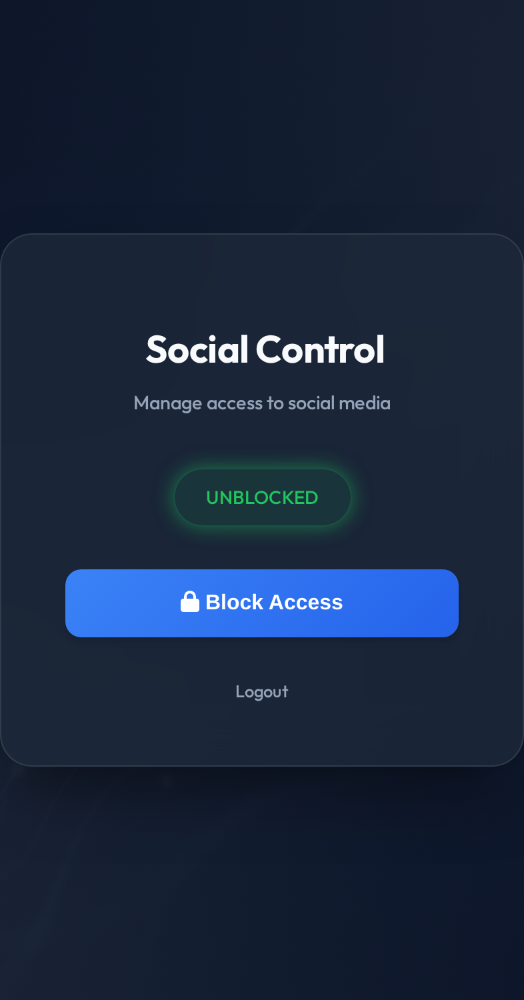

# PiHole Social Control

<p align="center">
  
</p>

<p align="center">
  <a href="https://github.com/hazemsamak/social-block/blob/main/LICENSE"></a>
  
  
  
  
  
</p>

A sleek, responsive web dashboard and Progressive Web App (PWA) designed to toggle access to distraction-heavy sites (like social media) for specific client devices on your network using Pi-hole.

---

## Table of Contents

- [Interface & States](#interface--states)
- [Key Features](#key-features)
- [Architecture](#architecture)
- [How It Works](#how-it-works)
- [Prerequisites](#prerequisites)
- [Pi-hole Configuration](#pi-hole-configuration)
- [Installation & Quick Start](#installation--quick-start)
  - [Option 1: Docker Compose (Recommended)](#option-1-docker-compose-recommended)
  - [Option 2: Bare Metal / Virtualenv](#option-2-bare-metal--virtualenv)
- [Configuration Reference](#configuration-reference)
- [REST API (v1)](#rest-api-v1)
- [Progressive Web App (PWA) Setup](#progressive-web-app-pwa-setup)
- [Development & Testing](#development--testing)
- [Contributing](#contributing)
- [License](#license)

---

## Interface & States

<div align="center">
  <table>
    <tr>
      <td align="center" width="50%"><b>Active Access (Social Allowed)</b></td>
      <td align="center" width="50%"><b>Restricted Access (Social Blocked)</b></td>
    </tr>
    <tr>
      <td align="center"></td>
      <td align="center"></td>
    </tr>
  </table>
</div>

---

## Key Features

- **Instant One-Click Control**: Block or unblock social media access with a single button press.
- **Real-Time WebSocket Sync**: Multiple open dashboards immediately sync state whenever access changes via Socket.IO.
- **Self-Healing Authentication**: Transparently detects expired Pi-hole API sessions (HTTP 401) and re-authenticates automatically.
- **Progressive Web App (PWA)**: Installable to your mobile home screen (iOS Safari & Android Chrome) for native app convenience.
- **Discord Webhook Alerts**: Posts rich status notifications to your Discord channel on every toggle event.
- **REST API (v1)**: Standard JSON endpoints to automate toggling from Home Assistant, iOS Shortcuts, or cron jobs.
- **Premium Glassmorphic UI**: High-contrast dark theme, fluid CSS micro-animations, and responsive layout.
- **Dockerized**: Containerized deployment with minimal resource footprint.

---

## Architecture



---

## How It Works

1. **Blocking**:
   - Enables the designated **"Social"** group within your Pi-hole instance.
   - Assigns the target `CLIENT_IP` to the "Social" group so that all associated domain blocklists and regex rules apply.
2. **Unblocking**:
   - Disables the "Social" group in Pi-hole.
   - Detaches the target `CLIENT_IP` from the group, restoring default DNS resolution.
3. **Broadcasting**:
   - Upon successful status transition, Socket.IO broadcasts the new state (`Blocked` or `Unblocked`) to all connected dashboards, and an alert is dispatched to Discord.

---

## Prerequisites

- A functioning [Pi-hole](https://pi-hole.net/) instance (v5 or v6 FTL API).
- Docker and Docker Compose (or Python 3.9+ for bare metal).
- *(Optional)* A Discord Webhook URL for channel notifications.

---

## Pi-hole Configuration

Before running the application, set up the **Social** group in your Pi-hole web dashboard:

1. Navigate to **Pi-hole Admin** > **Groups**.
2. Add a new group named exactly `Social`.
3. Go to **Domains** or **Adlists**:
   - Add your chosen social media blocklists (e.g., blocklists for TikTok, Instagram, Facebook, YouTube, Twitter/X).
   - In the **Group Assignment** dropdown, assign these lists to the `Social` group.
4. Note your Pi-hole password (or API token/app password in Pi-hole v6) and target client device IP address.

---

## Installation & Quick Start

### Option 1: Docker Compose (Recommended)

1. **Clone repository**:
   ```bash
   git clone https://github.com/hazemsamak/social-block.git
   cd social-block
   ```

2. **Configure environment variables**:
   ```bash
   cp .env.example .env
   ```
   Edit `.env` with your Pi-hole IP, credentials, and app password.

3. **Start the container**:
   ```bash
   docker compose up -d --build
   ```

4. **Access the web interface**:
   Open `http://<your-server-ip>:5000` in your browser.

---

### Option 2: Bare Metal / Virtualenv

1. **Create and activate a virtual environment**:
   ```bash
   python3 -m venv venv
   source venv/bin/activate  # On Windows: venv\Scripts\activate
   ```

2. **Install dependencies**:
   ```bash
   pip install -r requirements.txt
   ```

3. **Configure environment**:
   ```bash
   cp .env.example .env
   # Edit .env with your configuration
   ```

4. **Run the server**:
   ```bash
   python run.py
   ```

---

## Configuration Reference

Configure the application by creating a `.env` file in the project root:

| Variable | Required | Default | Description |
| :--- | :---: | :--- | :--- |
| `PIHOLE_URL` | **Yes** | `http://192.168.1.100:80` | Base URL of your Pi-hole web interface (including port). |
| `PIHOLE_PASSWORD` | **Yes** | — | Web password for Pi-hole authentication. |
| `CLIENT_IP` | **Yes** | `192.168.1.50` | IP or CIDR subnet of the client device to block/unblock. |
| `APP_PASSWORD` | **Yes** | `admin` | Password required to log into this web dashboard. |
| `FLASK_SECRET_KEY` | **Yes** | `default_secret_key` | Random cryptographic key used to sign session cookies. |
| `DISCORD_WEBHOOK_URL`| No | — | Optional Discord Webhook URL for status change notifications. |

---

## REST API (v1)

The application includes a REST API under `/api/v1` for easy integration with automation tools (e.g., Home Assistant, iOS Shortcuts, Stream Deck).

> **Note**: API requests require a valid session cookie (authenticated via `/login`).

### 1. Get Current Status

```http
GET /api/v1/social/status
```

**Example Response**:
```json
{
  "status": "Blocked"
}
```

---

### 2. Toggle Status

```http
POST /api/v1/social/toggle
Content-Type: application/json

{
  "action": "block"
}
```
*(Accepts `"action": "block"` or `"action": "unblock"`)*

**Example Response**:
```json
{
  "success": true,
  "status": "Blocked"
}
```

---

## Progressive Web App (PWA) Setup

You can install PiHole Social Control on your mobile device as an app without going through an app store:

<div align="center">
  
</div>

<br/>

- **iOS (Safari)**:
  1. Open the dashboard URL in Safari.
  2. Tap the **Share** button (box with upward arrow).
  3. Scroll down and tap **Add to Home Screen**.

- **Android (Chrome)**:
  1. Open the dashboard URL in Chrome.
  2. Tap the three dots menu in the top right.
  3. Tap **Install app** or **Add to Home screen**.

---

## Development & Testing

Run unit tests locally:
```bash
python -m unittest discover tests
```

Or run tests within the Docker container:
```bash
docker compose exec pihole-control python -m unittest discover tests
```

---

## Contributing

Contributions, issues, and feature requests are welcome! Please check the [CONTRIBUTING.md](CONTRIBUTING.md) guide and read our issue templates before submitting a PR.

---

## License

This project is open-source and licensed under the [MIT License](LICENSE).
